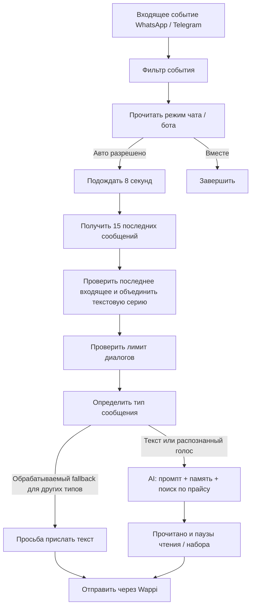

# Аудит приложения, автоответов и подсказок

Первичная проверка: 15 сентября 2026. Повторная проверка: 16 сентября 2026. Исходники и рабочий n8n проверены без изменения ботов и без отправки сообщений клиентам.

## Уточнения после повторной проверки 16 сентября

Основные выводы A1–A7 и S1–S7 сохраняются, но уровень доказательства разный: **дефект кода**, **историческое наблюдение** и **риск, требующий теста на устройстве**, — не одно и то же.

1. Повторно получены 21 workflow. Проверены также `activeVersion`: у активных workflows опубликованные узлы и связи совпадают с прочитанной конфигурацией. Активность ботов «13»/«15» осталась прежней.
2. Расхождение `Support Message` объяснено: в репозитории `chatId` заменён на `__CHAT_ID__`, на сервере стоит настроенный получатель. **Это штатная подстановка, не обнаруженная неисправность или рассинхронизация.**
3. В A2 добавлена существующая частичная защита: повторное открытие чата повторно отправляет его ЯВНО заданный override. Наследуемый режим бота этим не восстанавливается. Обычное переключение по-прежнему без подтверждения/повтора.
4. Найдены дополнительные проявления A2: отказ `SetReplyMode` может вернуться с HTTP 200 и ошибочно считаться клиентом успехом; Create-workflows активируют нового бота до последующей клиентской записи «Вместе».
5. A3/A4 воспроизведены отдельно на неизменённом коде обоих шаблонов и обоих созданных ботов. При этом контрольные случаи проходят: более новое входящее и чужой chatId отменяют старое выполнение. Это **проверка прохода алгоритма**, не доказательство, что дубль уже был отправлен реальному клиенту.
6. Выполнения 1967, 1971, 1994 получены заново: правила воздержания присутствовали уже в их историческом промпте, но возвращались карточки для личного разговора. Входы смешаны по языку, поэтому уверенный вывод о неспособности отвечать на казахском был бы неверен.
7. Выполнение 1809 сегодня возвращает 404. Его 87,876 секунды и статистика первоначальных 12 запросов остаются **наблюдением первой проверки**, без повторного доступа к исходной записи. Приписывать ей подтверждённый показ ошибки на телефоне нельзя: сопоставленного клиентского лога нет.
8. Перепроверен запрос первого smoke-прогона, выполнение 3069: `missing_app_user_id`, модель вообще не запускалась. Это дефект актуальности тестового payload, не провал генерации модели.
9. S4 уточнён: историю теряет именно поисковый запрос, а генератор получает последние сообщения. S6 остаётся риском по коду, без воспроизведения пользовательского сценария на устройстве.
10. Приоритеты уточнены: перед изменениями нужен короткий этап воспроизводимых проверок; затем защита доступа и отправки. Редизайн, смена модели, многоустройственная синхронизация и сокращение больших классов не являются обязательными исправлениями подтверждённых дефектов.

Повторная проверка не превратилась в сквозной тест приложения: Unity/телефон повторно не использовались, действительные отправки и покупки не запускались. Машиночитаемые обезличенные результаты сохранены в [2026-09-16-recheck-evidence.json](/Users/ayan/Projects/Automation/docs/audits/2026-09-16-recheck-evidence.json). Пошаговая инструкция для исполнителя: [2026-09-16-claude-code-remediation-prompt.md](/Users/ayan/Projects/Automation/docs/audits/2026-09-16-claude-code-remediation-prompt.md).

## Главный вывод

У приложения понятная ценность: владелец бизнеса управляет WhatsApp и Telegram, получает помощь с ответами и может передать часть переписки боту. Сильные стороны — отраслевые сценарии, работа с прайсами, режим «Вместе», обработка серий сообщений и продуманная клиентская логика.

Главные ограничения находятся на стыках: подтверждение режима сервером, передача разговора человеку, полнота общей истории, одинаковое понимание данных в двух режимах и защита доступа. Переписывание всех промптов не устранит эти проблемы.

Моя оценка: пригодная основа для управляемого пилота. Для массового использования с самостоятельными автоответами сначала нужны исправления доступа и контроля отправки, затем — измерение качества на бизнес-диалогах.

## Что действительно проверено

- Прочитаны архитектура и ключевые пути приложения: создание/настройка бота, режимы ответа, подготовка контекста, подсказки, уведомления, сводка, онбординг и хранение настроек.
- Просмотрены сохранённые снимки основных экранов из `Tools/store/screenshots/`. Это демонстрационные материалы, а не новый проход по работающему приложению.
- Через API рабочего n8n прочитаны 21 workflow: 19 служебных/шаблонных и два созданных бота — «13» и «15». На момент проверки «15» активен, «13» выключен; оба используют WhatsApp-шаблон. Выключенные исходные WA/TG-шаблоны сами по себе нормальны: они нужны для клонирования.
- У 18 из 19 канонических workflows параметры узлов и связи совпали с рабочим сервером. У `Support Message` отличие — штатная подстановка получателя вместо экспортного `__CHAT_ID__` (уточнение 16 сентября). У двух созданных ботов от WA-шаблона отличаются только webhook и системный промпт. Признаков устаревшей структуры именно этих двух клонов не обнаружено.
- Прочитаны подробности 72 сохранённых выполнений: по 30 у каждого бота и 12 у подсказок. Все имеют статус `success`, однако 60 выполнений ботов остановились на фильтре входа или подавлении автоответа. Они **не доказывают качество генерации или доставки автоответов**.
- Выполнены четыре существующие проверки workflows и два локальных воспроизведения на неизменённом JavaScript рабочего `Latest+Combine`.
- Один синтетический запрос из существующего smoke-теста отправлен в `SuggestReplies`: он вернул `generation_failed`. Этот endpoint возвращает карточки и не отправляет сообщения в мессенджеры.

### Границы проверки

Unity MCP завершил запрос по тайм-ауту, подключённых Android-устройств нет. Поэтому не проверены заново клавиатура, жесты, авторизация на телефоне, покупка/восстановление подписки и поведение на фоне. Новые генерации автоответов с отправкой не запускались. Прямой аудит рабочих таблиц Supabase и инфраструктурного периметра не выполнялся; проверены запросы и узлы, которые с ними работают.

Частные сообщения, номера и ключи доступа в отчёт не включены. Небольшая история подсказок относится в основном к личной переписке; выводить из неё процент качества продаж нельзя.

## 1. Приложение как продукт

### Плюсы

1. **Понятная структура.** Чаты, сводка, боты и профиль соответствуют основным задачам владельца. По сохранённым снимкам интерфейс визуально согласован, основные действия хорошо заметны.
2. **«Вместе» — полезный самостоятельный сценарий.** Владелец видит варианты, выбирает направление и редактирует ответ. Это позволяет пользоваться помощником ещё до доверия к полной автоматизации.
3. **Настройка под шесть отраслей.** Автозапчасти требуют данных автомобиля, ремонт — модели и проблемы, цветы — повода и бюджета. Это существенно полезнее одного общего «продающего» промпта.
4. **Несколько способов дать знания.** Описание бизнеса, контакты, товары/услуги и загруженные прайсы. Фото прайса проходит распознавание; неподходящее изображение может быть отклонено явно.
5. **Техническая проработка чата.** Кэш, согласование отправленных сообщений с серверным эхом, защита от чужого контекста, обработка медиа и последовательности запросов. Это реальные сильные стороны исходников, хотя новый тест на устройстве здесь не проводился.
6. **Сводка ориентирована на результат.** «Заявка» и «Нужен владелец» ближе к работе бизнеса, чем простой счётчик сообщений. Но ограничения её источника данных существенны — ниже.
7. **Есть проверки и воспроизводимые правила.** Проект уже выделяет важную логику в тестируемые компоненты и содержит проверки серверных workflows.

### Минусы и точки роста

- **Недостаточная видимость реальной готовности бота.** Подключённый канал и выбранный режим не означают, что сервер принял настройки, имеет достаточные знания и успешно отвечает. Нужен короткий экран проверки готовности и пробный диалог без отправки клиенту.
- **Режим обозначен косвенно.** На снимках и в коде включённое/выключенное состояние одной надписи «Авто» различается лампой и заливкой. Это компактно, но новый пользователь может не понять, кто отвечает сейчас и относится ли действие ко всему боту или одному чату. Это UX-оценка, не доказанный дефект удобства.
- **Нет push-инфраструктуры.** Настройки уведомлений управляют звуком, вибрацией и значками внутри приложения. Для сценария «бот позовёт владельца, когда потребуется» этого недостаточно. Возможные уведомления самого WhatsApp не заменяют отдельную передачу заявки.
- **Настройки бота в основном привязаны к устройству.** PlayerPrefs — фактическое хранилище локальных сущностей. Нельзя считать наличие серверного workflow полноценной синхронизацией рабочего места и восстановлением настройки на другом телефоне.
- **Онбординг может принять ручной ответ за ответ бота.** `OnboardingFirstReplyLatch` засчитывает любое исходящее сообщение, включая сообщение владельца. Это принятое ранее упрощение, но такой чек-лист не является проверкой работоспособности AI.
- **Высокая сложность сопровождения.** Основной `Manager.cs` — 4475 строк, `ChatManager.cs` — 2460, контроллер подсказок — 1554, помимо partial-файлов. Размер сам по себе не ошибка, но разные жизненные циклы и состояния повышают стоимость каждой доработки.

## 2. Как работает автоответ

Память имеет ключ `profileId:chatId`, параметр окна — 50. Поиск по документам выполняется инструментом модели, `topK=10`, с фильтром по собственному workflow ID и отдельным ключом канала. В рабочей конфигурации модель автоответа — `gpt-5.4-mini`, лимит `maxTokens=200`.

### Что сделано хорошо

- Проверка «Вместе» стоит до генерации и поиска: подавленный ответ не расходует запрос к модели.
- Отдельная настройка чата имеет приоритет над настройкой бота.
- Текстовые сообщения, отправленные подряд, объединяются: клиент может написать мысль несколькими пузырями.
- Есть фильтр чужого `chatId` в ответе транспорта, повторные попытки получения истории и изоляция памяти по профилю.
- Прайсы WA/TG фильтруются отдельно. Это хорошая изоляция поиска внутри workflow; она не заменяет проверку прав на публичном endpoint.
- Голос распознаётся перед ответом; для некоторых других типов предусмотрена просьба прислать текст.

### A1. Критично: управление и данные недостаточно защищены проверкой владельца

**Подтверждено кодом и рабочими определениями workflows.** `Set Workflow State` имеет `authentication: none`; его проверка смотрит формат ID, допустимое действие и список защищённых служебных workflows. Проверки, что вызывающий владеет целевым ботом, нет. Разрешены activate/deactivate/delete. Другие клиентские endpoints также доверяют переданным ID; проверка существования подписчика в подсказках не доказывает владение переданными profile/workflow ID.

Дополнительно Wappi-токен загружается из поставляемого `StreamingAssets/secrets.json`. Перенос n8n admin key из клиента — уже сделанный правильный шаг, но транспортный секрет остаётся в клиентской конфигурации.

**Последствие:** нельзя полагаться на знание случайного ID как на право изменять бота или обращаться к его данным. Фактическую эксплуатацию и область прав Wappi-токена не проверял.

**Повторная проверка:** пустой запрос без аутентификации к `SetWorkflowState` дошёл до прикладной проверки и вернул HTTP 400 `bad_request`. Локальный запуск опубликованного Validate с вымышленным корректным ID и действием `deactivate`, без личности пользователя, вернул `ok=true`. Это подтверждает отсутствие проверки владельца в данном пути, не факт успешного захвата чужого бота. Непустой Wappi-токен в локальном StreamingAssets подтверждён без вывода значения; конкретный опубликованный APK/IPA не распаковывался.

**Исправление:** серверная идентичность владельца, проверка принадлежности каждого объекта, транспортные credentials только на сервере. Подписка должна проверяться после установления личности. Общий секрет внутри APK не решает задачу разграничения пользователей. n8n поддерживает [аутентификацию webhook](https://github.com/n8n-io/n8n-docs/blob/main/docs/integrations/builtin/credentials/webhook.md), но права на конкретный бот всё равно требуют отдельной проверки.

### A2. Высокий: приложение подтверждает режим до подтверждения сервера

`ReplyModeToggleBinder.CommitMode` сохраняет выбор и уведомляет интерфейс сразу. `Manager.SyncReplyModeRoutine` отправляет запрос один раз; при ошибке пишет в лог. Обычный путь переключения не показывает ошибку, не откатывает состояние и не ставит повторную доставку. Аналогично устроен per-chat toggle.

**Сценарий:** владелец выключил автоответ, сеть пропала → интерфейс показывает выключенное «Авто», серверная запись осталась прежней.

В `SaveWorkflows` уже есть полезная защита: при активации канала в режиме «Вместе» код ждёт запись подавления. Это не закрывает обычное переключение кнопкой.

**Уточнение:** `RestoreForActiveChat` повторно пишет ЯВНО установленный режим данного чата при его открытии — полезное частичное восстановление. Для наследуемого режима (`*`) здесь записи нет. Это не очередь повторов и не подтверждение самого нажатия.

**Новый подтверждённый случай:** `SetReplyMode` на `{}` вернул HTTP 200 с `success:false,error:bad_request`. `SyncReplyModeRoutine` считает успехом только `UnityWebRequest.Result.Success`, тело ответа не проверяет. Пустые profileIds обычный клиентский метод отсекает, поэтому этот тест не доказывает, что нормальный пользователь отправляет `{}`; он доказывает дефект протокола подтверждения.

**Окно первоначального включения:** оба Create-workflow имеют `Activate Created Workflow`, но не записывают `reply_mode_flags`. Клиентский `SeedReplyModeDefaultForProfile` выполняется уже после получения созданного ID; по отсутствующей записи сервер разрешает Авто. При поступлении сообщения между активацией и seed новый бот может пройти проверку режима, хотя клиентский выбор — «Вместе». Защита в `SaveWorkflows` не устраняет этот отдельный путь.

**Исправление:** хранить желаемый и подтверждённый режимы, надёжно доставлять последнее состояние, отображать незавершённое переключение. Нужна также защита от переупорядоченных быстрых переключений.

### A3. Высокий: уже начавшийся ответ не отменяется

Режим читается один раз до восьмисекундной паузы. После генерации и перед отправкой нового чтения режима нет. Новое сообщение клиента, ручной ответ или переключение режима за это время не отменяют готовящийся ответ.

**Локальное воспроизведение на рабочем `Latest+Combine`:** в истории новое исходящее владельца расположено после сообщения клиента. Результат — `abort=false`, `combinedText=null`; затем Text использует исходный текст webhook. То есть ручной ответ не останавливает проход.

Повторено 16 сентября для WA, TG и двух созданных WA-ботов. Это не означает, что алгоритм игнорирует все новые сообщения: входящее, которое уже видно во время Fetch Recent, отменяет старое выполнение корректно. Незащищены ручной ответ и изменения после последней проверки.

**Исправление:** контроль актуальности непосредственно перед отправкой: режим, последнее входящее, последнее вмешательство владельца. При изменении контекста ответ отменять или пересчитывать. Проверка должна дополнять защиту от параллельных выполнений.

### A4. Высокий: нет гарантии однократной обработки события

Debounce выбирает последнее сообщение, но не фиксирует уникальную обработку его ID. Два запуска с одним и тем же событием и одной историей оба получили `abort=false` в воспроизведении. В проверенной цепочке нет атомарного захвата события перед генерацией/отправкой.

**Исправление:** постоянный ключ `(profileId, chatId, messageId)` и атомарное право обработки, плюс последовательная обработка одного чата. Счётчик оплачиваемого диалога не является защитой от повторного ответа.

**Граница гарантии:** уникальная запись в БД сама по себе не обеспечивает строго однократную внешнюю доставку. Если Wappi принял сообщение, а HTTP-ответ потерялся, слепой retry может отправить дубль. Нужны отдельное состояние неопределённой отправки и сверка с транспортом; поддержку idempotency key у Wappi нужно проверить, а не предполагать.

### A5. Высокий: «Передаю менеджеру» — текст без гарантированного действия

Отраслевые промпты обещают передать заявку, но инструменты агента — память и поиск по документам. Нет отдельного инструмента создания заявки, уведомления ответственного, подтверждения получения и приостановки бота до ответа человека.

Сводка классифицирует историю по запросу приложения и может показать `owner_needed`. Это полезно, но это не очередь задач с уведомлением.

**Исправление:** результат `нужен человек` должен создавать запись заявки и уведомление; бизнес определяет ответственного и часы реакции. Клиенту сообщать только реально выполненное действие.

### A6. Высокий: память и сводка не отражают всю ручную переписку

Создание бота регистрирует `incoming_message`. Память подключена к AI Agent; в режиме «Вместе» выполнение завершается раньше. В проверенных workflows нет отдельного импорта всех ручных сообщений и переписки из «Вместе» в эту память. Fetch Recent использует исходящие как границу объединения, но не передаёт полный полученный диалог агенту.

**Следствие по архитектуре:** после работы человека бот может не знать договорённость. Сводка читает `n8n_chat_histories`, поэтому её нельзя представлять как полную аналитику всех разговоров в двух режимах.

**Исправление:** единая история с источником сообщения — клиент/человек/AI, отдельное структурированное состояние заявки и явное возобновление автоматизации после человека.

### A7. Средний: декоративные действия блокируют доставку

После генерации стоят Mark Read и Typing без продолжения при ошибке. Их сбой может остановить отправку уже подготовленного ответа. Паузы чтения и печати вычисляются как число слов / 2 + 2 секунды, дополнительно к debounce и работе модели. Например, 10 слов входа и 40 слов выхода добавляют 7 + 22 секунды только этими двумя паузами.

**Исправление:** ограничить суммарную задержку; сбои статуса «печатает» и отметки прочтения не должны губить основной ответ. Отдельно учитывать ошибки генерации и ошибки доставки.

## 3. Качество промптов автоответа

### Сильные решения

- Конкретные вопросы перед подбором вместо преждевременной цены.
- Запрет выдуманных цен, артикулов и условий.
- Отделение наличия позиции в прайсе от реального остатка.
- Сбор заявки по шагам; для образования — без гарантии результата, для ремонта — без окончательной диагностики в чате.
- Русский/казахский по языку клиента, короткий формат, ограничения на оплату, бронь и другие действия без человека.

### Что нужно исправить

1. **Противоречие источников цены.** Общие правила допускают сведения из Products/Services, но затем требуют называть только цены из Supabase Vector Store. Вручную введённая цена в системном контексте может быть известна, а правило запрещать её использовать при пустом файловом прайсе. Нужен единый приоритет источников и обработка расхождений.
2. **Встроенная подсказка «Заканчивай сообщение вопросом» создаёт неоднозначность с базовым «Ответил — остановись».** В отраслевых сценариях уточнения уже разрешены, поэтому не каждый вопрос нарушает базу; проблема — безусловное «каждое сообщение» без ясного приоритета. Реальное нарушение на генерации здесь не воспроизводилось. Лучше уточнять вопрос только для следующего необходимого шага.
3. **В автоответе нет актуального времени бизнеса.** Промпты дают инструкции на ночь/нерабочее время, но в проверенном вводе агента не передаются текущая дата и часовой пояс бизнеса. В «Вместе» передаётся время телефона, которое при поездке тоже не обязательно равно времени бизнеса.
4. **База местами обещает слишком много.** «Заказ принят» и «подтвердит утром» требуют реального процесса исполнения. Фраза о том, что мастер не заходит в данные устройства, также не должна автоматически становиться фактом любого выбранного бизнеса.
5. **Излишнее дублирование.** Рабочие промпты созданных ботов содержат примерно 8,3–8,5 тыс. символов, включая повторный «справочник по общим правилам». Повторы могут усиливать стиль, но усложняют приоритеты и поддержку. У обоих проверенных ботов текстовые разделы About Business/Products/Services пусты; наличие загруженных прайсов этим не опровергается.
6. **Лимит 200 токенов нужно проверить на многошаговых ответах.** Он может оказаться тесным для списка позиций или сводки заказа. Обрезанный автоответ в этой проверке не наблюдался; это риск конфигурации, а не установленный случай.
7. **Нет отдельной проверки фактов перед отправкой.** Запрет в промпте снижает риск, но не проверяет, что конкретная цена, обещание или артикул действительно присутствуют в источнике.

Рекомендуемая структура: неизменяемые правила действий → отраслевые правила → проверенные факты бизнеса → стиль владельца → состояние заявки → актуальный диалог. Цены, остатки и возможность действия желательно возвращать структурированно, с источником, а не прятать только в свободном тексте.

## 4. Как работают подсказки «Вместе»

1. Контроллер собирает изменения переписки и объединяет серию входящих; при повторном открытии может использовать кэш.
2. В запрос уходят последние 24 сообщения, до 500 символов каждое, настройки бизнеса, каталог, пожелания владельца и направление выбранной карточки.
3. Сервер проверяет подписчика и общий лимит 100 запросов в день на аккаунт. Подсказки не списывают оплачиваемые диалоги; повторная генерация всё равно использует дневной счётчик запросов.
4. По последней серии входящих выполняется один поиск по прайсу, `topK=5`; выдержки ограничены 4000 символами.
5. Отдельный отраслевой промпт пишет от лица владельца. Модель — `gpt-4o-mini`, temperature 0.4, max_tokens 700, строгая JSON-схема.
6. При нескольких полезных направлениях формируются 2–4 карточки; при одном — четыре варианта. Выбор направления запрашивает новый набор внутри него. Для неуместного разговора допускается пустой массив.
7. Валидатор проверяет структуру, текст, названия и допустимые move; неудачный ответ повторяется один раз. Второй валидатор допускает удаление карточек с повторяющимися заголовками.
8. Клиент отбрасывает устаревшие результаты по последовательности/чату. Отправка остаётся действием владельца.

### Что здесь сильнее автоответа

Есть отдельная роль автора, строгий формат, явное воздержание, проверка названий, повторная попытка и человеческая проверка перед отправкой. Это хорошая основа. Статистика выбранных ходов помогает ранжированию; это не полноценное обучение модели личному стилю.

### S1. Высокий: контекст двух режимов неравноценен

`N8nSuggestionsProvider.AppendCatalogItems` берёт только Name и Price. Description не передаётся, хотя автоответ получает его в ProductsList/ServicesList. Например, «цена включает установку» или ограничения совместимости могут быть известны автоответу и отсутствовать в подсказке.

Дополнительно режутся каталог до 2500, инструкция до 2000, сведения о бизнесе до 1200 символов. Обрезка с конца не учитывает важность и может удалить контакты после длинного описания. Поиск по загруженным файлам не гарантирует восстановление отсутствующих ручных описаний.

### S2. Подтверждено логами: воздержание от личной переписки непоследовательно

Из 12 сохранённых выполнений 9 вернули abstain, 3 — карточки. В выполнении 1967 на личные поздравления появились варианты ответа и встречные поздравления; в 1971 на эмоциональную реплику — «Что нового у вас?» и подобные карточки. В 1994 карточка смешивает казахское начало с русским продолжением.

Последний пример не является чистым тестом казахского языка: входной контекст сам смешанный. Но примеры подтверждают, что формальная валидность JSON не равна уместности ответа. Нужны отдельные оценки релевантности, воздержания, языка и обещаний.

### S3. Историческое наблюдение: время сервера превысило тайм-аут приложения

В 12 выполнениях время сервера: минимум 2,65 с, медиана около 4,94 с, максимум 87,876 с. В выполнении 1809 retrieval занял около 85,5 с, вложенный Embeddings — около 83,5 с; эти времена вложены, складывать их нельзя. Приложение ждёт 15 с.

Такой разрыв способен дать сценарий «ошибка в приложении, success в n8n», но в исходном аудите не было клиентского лога, подтверждающего именно этот показ ошибки. 16 сентября запись 1809 уже недоступна (HTTP 404); статистика выше относится исключительно к первоначальной выборке. Приложение по текущему коду по-прежнему ждёт 15 с. Нужен единый бюджет времени и явный результат недоступности поиска. Нельзя выдавать ответ без прайса как будто поиск состоялся. Повторный запрос должен избегать бесконтрольного дублирования работы и расхода лимита.

### S4. Средний: поисковый запрос может терять предмет короткого уточнения

Поисковый запрос строится по последней непрерывной серии входящих, максимум 500 символов. Предыдущие реплики доступны генератору, но не используются для полноценного разрешения ссылок в поисковом запросе. После «а сколько стоит?» предмет может остаться в предыдущем ходе. При уточнении карточки выбранное направление не становится отдельным поисковым запросом.

16 сентября запуск опубликованного Prep на «Нужен фильтр Camry 2019» → «Масляный фильтр?» → «Да, сколько стоит?» дал queryText только «Да, сколько стоит?», сохранив все три реплики для генератора. Подтверждена потеря предмета в запросе; конкретный неправильный результат векторного поиска на таком примере не измерялся.

Нужен небольшой этап восстановления предмета вопроса из истории и выбранного направления, затем поиск. Для артикулов и точных моделей стоит проверять точное совпадение наряду с семантическим поиском; доступная конфигурация вектора сама по себе не гарантирует точный подбор.

### S5. Средний: в модель уходит разметка интерфейса

В рабочих запросах 1967/1994 присутствуют TMP-теги `<sprite ...>` и `<space=...>`, а также невидимые символы. Клиент передаёт `MessageViewModel.text` без преобразования в чистый текст. Это лишние токены и помеха анализу коротких эмоциональных сообщений.

### S6. Риск по коду: кэш не знает об изменении знаний и времени

Ключ кэша — чат и последнее сообщение; срока действия и версии настроек/прайса в нём нет. Если чат остаётся в том же контексте бота без очистки кэша, ответ о цене или «сейчас работаем» может пережить изменение данных/времени. Нужны версия знаний и срок актуальности. При смене бота кэш уже очищается — это полезная существующая защита.

Повторно проверены подписки контроллера и очистка: обработчика изменения знаний нет; `SetActiveBot` для того же ID возвращается без события. Сценарий на устройстве пока не воспроизведён. При исправлении следует включить в область кэша канал/профиль, а не предполагать глобальную уникальность chatId.

### S7. Средний: разные правила бизнеса в двух режимах

Автопромпт Kaspi разрешает отвечать о рассрочке только по данным бизнеса. Промпт панели утверждает, что она у магазина есть всегда. Это подтверждённое расхождение текстов, независимо от внешних правил Kaspi. Условия конкретного магазина должны приходить из одного источника.

## 5. Проверки и наблюдаемость

| Проверка | Результат | Что это означает |
|---|---|---|
| `verify_rag.py all` | PASS | Заложенные инварианты обработки/изоляции документов соблюдены |
| `verify-panel-prompts.js` | PASS | Отраслевые блоки действительно включаются в составной промпт |
| `verify-message-batching.py` | FAIL | Проверка ждёт прямой переход в Input type, но между ними добавлен лимит диалогов |
| `verify-telegram-parity.py` | FAIL | Проверка продолжает требовать прежний bagkz-host вместо рабочего choosereply-host |
| Дубликат webhook, локальный запуск рабочего Code node | Оба проходят | Debounce не заменяет фиксацию обработанного события |
| Ручной ответ до Fetch Recent, тот же Code node | `abort=false` | Вмешательство владельца не отменяет проход |
| Один payload существующего smoke-теста против рабочего SuggestReplies | HTTP 200, `generation_failed` | Старый payload без appUserId не проверяет качество модели после появления subscription gate |

Два FAIL относятся к устаревшим проверкам, а не доказывают поломку рабочего алгоритма. Но с такими проверками нельзя уверенно оценивать следующий релиз.

16 сентября четыре команды повторены с теми же результатами. Падающие проверки останавливаются на первой ошибке, поэтому это **не утверждение, что все оставшиеся проверки в них пройдут после правки первого ожидания**. Smoke-запрос 3069 перепроверен по сохранённому выполнению: отказ из-за `missing_app_user_id`, узел LLM не выполнялся.

`success` в n8n также недостаточен: в выборке все 60 запусков ботов завершились до генератора. Нужны отдельные результаты: отфильтровано / подавлено режимом / запрещено лимитом / сформировано / доставлено / отменено из-за человека / ошибка.

Новый набор оценки должен проверять минимум: все шесть отраслей; известные и отсутствующие цены; только ручной каталог; загруженный прайс; конфликт источников; русский и казахский; голос; личную переписку; попытку изменить инструкции; серию сообщений; повтор webhook; вмешательство человека; смену режима; устаревший прайс; отказ поиска; закрытый/истёкший тариф.

Для каждого сценария нужны ожидаемое действие и запрещённые утверждения. Метрики: фактическая точность, полезность, соблюдение отраслевого уточнения, корректность передачи человеку, доставка без дублей, задержка до видимого результата. Одних проверок JSON недостаточно.

## 6. Рекомендуемый порядок работ

### Подготовительный этап — до исправлений

Сохранить версии/резервные копии, воспроизводимые синтетические примеры и исходные результаты проверок. Актуализировать проверки пути через лимит и разрешённых адресов сервера, сохранив их смысл. Завести статус по каждому пункту отчёта. Это короткий обязательный этап, а не большой предварительный рефакторинг.

### Сначала — контроль и безопасность

1. Установить серверную личность пользователя и проверять владение ботом; убрать Wappi-секрет из публичного клиента.
2. Сделать переключение режима подтверждаемым и надёжно доставляемым.
3. Ввести уникальную обработку события и последнюю проверку перед отправкой.
4. Ввести минимальное состояние чата/заявки и источник сообщений; затем настоящее действие передачи человеку и уведомление. Событие передачи должно быть надёжным и независимым от открытия сводки.

### Затем — одинаковые знания и диалог

5. Согласовать общую историю человека и AI, а также источник данных сводки.
6. Передавать описания товаров/услуг, нормальный текст сообщений, время бизнеса и версию знаний.
7. Устранить конфликтующие правила промптов и жёстко заданные бизнес-факты.
8. Улучшить поисковый запрос по коротким уточнениям и ввести общий бюджет ожидания.

### После — доказать качество и упростить эксплуатацию

9. Обновить устаревшие проверки и прогонять набор бизнес-сценариев до изменения модели/промпта.
10. Дать владельцу проверку готовности, пробный диалог и понятный статус последнего ответа.
11. Версионировать шаблоны и контролируемо обновлять клоны. Сейчас два проверенных клона актуальны, но изменение шаблона само по себе не обновляет уже созданные workflows.

Версионирование, проверка клонов и безопасный порядок развёртывания сопровождают каждый серверный этап, а не откладываются до самого конца. Изменение UX режима, новый вход в аккаунт, полная облачная синхронизация и большой рефакторинг — отдельные решения после проверки потребности; один только размер класса не основание переписывать его.

## Навигация по доказательствам

- [Синхронизация режима](/Users/ayan/Projects/Automation/Assets/Scripts/Main/Manager.ReplyModeSync.cs:128)
- [Мгновенное локальное подтверждение режима](/Users/ayan/Projects/Automation/Assets/Scripts/UI/ReplyModeToggleBinder.cs:72)
- [Каталог и тайм-аут подсказок](/Users/ayan/Projects/Automation/Assets/Scripts/Chat/N8nSuggestionsProvider.cs:100)
- [Сбор описаний для автоответа](/Users/ayan/Projects/Automation/Assets/Scripts/Main/Manager.cs:4055)
- [Кэш подсказок](/Users/ayan/Projects/Automation/Assets/Scripts/Chat/SuggestionCache.cs:17)
- [Основной WA-workflow](/Users/ayan/Projects/Automation/Tools/n8n/workflows/4wYitz5ek30SVNlT-WhatsApp_Bot.json:659)
- [Подсказки n8n](/Users/ayan/Projects/Automation/Tools/n8n/workflows/9PTyYcelRQI7bGDb-Suggest_Replies.json)
- [Управление workflow](/Users/ayan/Projects/Automation/Tools/n8n/workflows/0DP79STI3pafXO9B-Set_Workflow_State.json:16)
- [Сводка из памяти агента](/Users/ayan/Projects/Automation/Tools/n8n/workflows/2htWSV5IHO8E2CgB-Dashboard_Outcomes.json:38)
- [Общие правила автоответа](/Users/ayan/Projects/Automation/Tools/n8n/prompts/_core.md:7)
- [Рассрочка в панели](/Users/ayan/Projects/Automation/Tools/n8n/prompts/panel/kaspi_seller.md:7)
- [Встроенные мини-промпты](/Users/ayan/Projects/Automation/Assets/Scripts/Main/BotSettings/PromptSuggestionCatalog.cs:37)
- [Уведомления](/Users/ayan/Projects/Automation/Assets/Scripts/Main/ProfileSubPages.Notifications.cs:5)
- [Секреты клиентской конфигурации](/Users/ayan/Projects/Automation/Assets/Scripts/Main/Secrets.cs:17)
- [Критерий первого ответа](/Users/ayan/Projects/Automation/Assets/Scripts/Main/Onboarding/OnboardingFirstReplyLatch.cs:19)

Рабочие выполнения для внутренней перепроверки: 1809 — задержка поиска; 1967, 1971, 1994 — примеры уместности карточек. Сырые ответы API прочитаны для аудита и не помещены в репозиторий.
